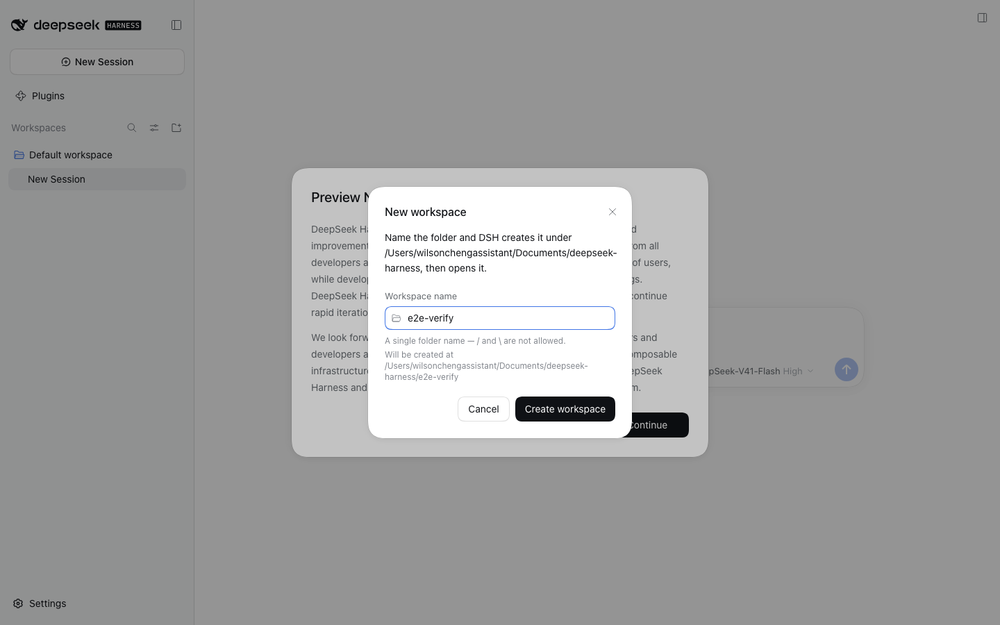
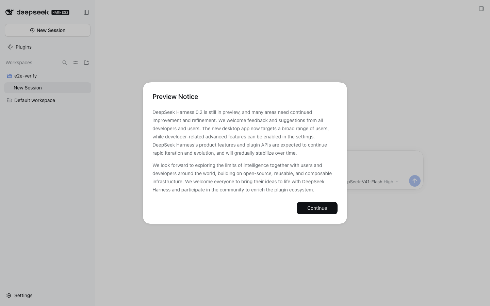

# dsh-quick-workspace

Make the sidebar's **Add workspace** button work when you are driving the DeepSeek
Harness web UI from somewhere other than the host machine.

## What was wrong

The stock flow opens an **OS folder chooser on the host**. `dsh-host-directory-picker-auto`
resolves the `native` backend whenever the bind host is `127.0.0.1` on macOS, and that
backend is a renderless `osascript "choose folder with prompt …"` call: it puts a Finder
dialog on the host's screen and renders **nothing** in the browser.

So from a remote browser (Tailscale, LAN, a phone) the button looks completely dead, and
it gets worse than dead — while the hidden dialog is open, `WorkspacePickFlow` holds
`directoryBusy`, and `shortcutControls.add` is a no-op whenever that flag is set. Every
later click is then silently ignored, with no error and nothing on screen.

## What this plugin does

It occupies both directory-flow holes — the sidebar header button and the composer's
*Choose workspace* — with a **name dialog**:

1. you type a name,
2. the dialog shows the exact path it is about to create,
3. DSH makes the folder and registers it as a workspace, then opens it.





New folders land **beside the deployment's default workspace**, which on this machine is
`~/Documents/deepseek-harness/` for a workspace at `~/Documents/deepseek-harness/default-workspace`.

It registers at `priority: -100`, which is the documented way to *shadow* a single-kind
slot occupant: `SlotCore.register` sorts entries by ascending priority and the lowest
renders, so this takes the seat instead of throwing `already has a registration` against
the native/browse picker.

## Install

```bash
dsh plugin --profile web add file:/path/to/plugins/dsh-quick-workspace
```

Then restart `dsh web` so the host half re-imports (see below).

## Two things that bite when editing this

- **`lib/index.js` needs a `dsh web` restart.** The client half hot-reloads; the host half
  does not. After editing `lib/index.js`, `rm -rf ~/.dsh/profiles/web/node_modules/dsh-quick-workspace`
  and re-add, or restart the server.
- **`process.cwd()` is `/`.** `dsh web` runs as a launchd KeepAlive agent, so the working
  directory is the filesystem root, and `mkdir("/<name>")` fails with a bare `EACCES` that
  tells the user nothing. The parent comes from `workspaceRegistry` instead, and the root
  is refused outright with `quick-workspace/no-parent`.

## Wire shapes worth remembering

- `ctx.connection.rpc.call("/api", "ns/method", payload)` resolves to the
  `{ok, value | error}` envelope. Reading `.path` straight off it yields `undefined`
  **without throwing** — always unwrap.
- The Gateway derives its argument descriptor from the Host method's signature. A
  parameterless `describe()` must be sent `{args: {}}`; `{args: {request: {}}}` is rejected
  with `gateway/arguments-invalid`.

## Uninstall

`dsh plugin --profile web remove dsh-quick-workspace` (or disable it on the Plugins page),
then restart `dsh web`. The stock folder picker comes back.
